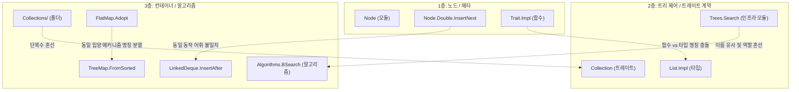

# Gemini(agy) 이름 검토, 외부자 시선 — 원문 + 메인 검증 (2026-10-13)

> **작성**: Gemini 3.8 Flash(High), `delegate-agy` 과제 `names-out`(worktree `agy/names-out`, 기준 `37caff9`).
> 과제: "이 라이브러리를 처음 보는 Luau 개발자로서 이름만 보고 짐작한 뜻과 실제 뜻의 거리". 입력은 이름 목록
> (이름 + 그것이 무엇인가 — 지은 이유는 뺌)과 `src/` 뿐이고 설계 문서는 읽지 말라고 했습니다. 읽기 전용,
> `luau` 실행 없음. worktree 에 생긴 것은 보고서 파일 하나. 아래 "원문" 은 보고서 그대로입니다(결정 아님).
> 같은 목록을 sonnet 외부자·내부자, Gemini 내부자(`2026-10-13-names-in.md`)에게도 줬고, 넷을 견준 표는
> `question.md` AU 에 있습니다.
>
> **메인 검증(2026-10-13)** — 사실 주장을 소스에서 직접 확인:
> - **인용 줄 여덟 곳**(`Trait.luau:92·297·445·468`, `List.luau:38·78`, `Arr.luau:2334`, `TreeMap.luau:439`,
>   `Double.luau:52·65`, `LinkedDeque.luau:216·232`)은 기준 커밋에서 전부 맞음.
> - **틀림 1**: `Common.expectComparator` 가 "유일하게 camelCase" — `Common` 의 함수 열 개가 전부 camelCase
>   (`listLength`·`raise`·`lessFrom` …). 어긋나는 것은 `Search.ExpectBalance` 와의 짝이지 `Common` 안이 아님.
> - **틀림 2**: `TreeMap.FromSorted` 가 `Adopt` 와 "완전히 동일한 메커니즘" — 아님. `HashMap.Adopt`·`FlatMap.Adopt`
>   는 넘긴 테이블을 그대로 가지고(소유권 이전), `FromSorted` 는 목록을 읽어 노드를 새로 만듦. 같은 것은
>   "전제를 검사하지 않는다" 뿐. 다만 **그 오해를 부른 것은 우리 주석**("`Adopt` 와 같은 문")이었음 → 주석을 고침.
>   그래서 4순위 제안(`TreeMap.Adopt` 로 통일)은 받지 않음.
> - **맞음, Gemini 만 짚음**: `Node.Double.InsertNext`/`InsertPrev` 대 `LinkedDeque.InsertAfter`/`InsertBefore`
>   (같은 동작, 층마다 다른 낱말), `Arr.GroupBy` 가 다른 언어의 `groupBy` 와 달리 목적지를 필수로 받음.
> - **맞음, 다른 검토와 겹침**: `Trait.NewType`(넷 전부), `Trees/Search`(넷 전부), `Trait.Dispatch`(넷 전부),
>   `Trait.Impl` 대 `List.Impl`(넷 전부 — 어느 쪽을 바꿀지는 갈림), `Trait.Module`(셋), `FlatMap`(외부자 둘).
> - 어조가 단정적("극심한", "100%")이라 근거로만 판단. `FlatMap` 이 함수형 `flatMap` 으로 읽힌다는 것은
>   sonnet 외부자도 독립적으로 같은 오해를 해서 무게가 있음(내부자 둘은 C++ `flat_map` 계보로 유지).

---

# stl-luau 이름 검토 보고서 — 외부자 시선

- **작성자**: Gemini (외부 리뷰어 관점)
- **기준 커밋**: `37caff9ac61dd0aab5ad0f8a1896280410821b0c` (실측: `git rev-parse HEAD`)
- **검토 범위**: `src/` 공개 표면, 함수 서명, 타입 선언 및 모듈 반환 테이블
- **분석 전제**: 이 라이브러리를 처음 접하는 Luau/Roblox 개발자의 직관을 기준으로 검토함. (내부 설계 문서를 배제하고 외부에 노출된 인터페이스의 어휘와 구조만으로 판단)

> **안내**: 본 보고서의 모든 대안 및 변경 권고는 **제안**이며, 최종 결정 권한은 프로젝트 관리자(사용자)에게 있습니다. 직접 실행하여 확인한 사실은 **[실측]**, 코드를 읽고 분석한 내용은 **[추정]**으로 구분하여 표기했습니다.

---

## 1. 이름별 첫인상(짐작) vs 실제 뜻 & 괴리도 분석

라이브러리를 처음 접한 개발자가 이름을 보았을 때 직관적으로 떠올리는 **짐작**과 실제 구현된 **뜻** 사이의 괴리를 **상/중/하**로 분류했습니다.

### 1) 폴더 및 모듈 구조

| 이름 | 처음 봤을 때 짐작 | 실제 뜻 (라이브러리 구현) | 괴리도 |
|---|---|---|:---:|
| `src/Trait.luau` | 트레이트 기본 인터페이스 선언 또는 공통 트레이트 정의 모음 | 트레이트 시스템 메타 모듈 (토큰 생성, 트레이트 등록/조회, 디스패치 런타임 엔진) | **중** |
| `src/Traits/` | 다양한 트레이트(인터페이스) 정의 파일 폴더 | 각 트레이트의 계약 타입 + 기본 구현(Provided methods) + 다형 진입점 함수 모듈 | **하** |
| `src/Collections/` | 완성된 컨테이너 컬렉션 구현체 모음 | `Arr`, `HashMap`, `TreeMap`, `LinkedDeque` 등 구체 컨테이너 구현체 | **하** |
| `src/Node/` | DOM/씬 트리 노드 또는 그래프 노드 자료구조 | 번호 인덱스(`[1]=값`, `[2]=다음` 등) 기반 저수준 노드 부품 (1층 프리미티브) | **중** |
| `src/Trees/` | 완성된 트리 컨테이너 모음 (`local rb = RedBlack.New()`) | 컨테이너가 아니라 루트 노드를 받아 구조/균형만 제어하는 2층 순수 알고리즘/도구 모음 | **상** |
| `src/Trees/Search.luau` | 이진 탐색 알고리즘 또는 트리 탐색 함수 모음 | 균형 무관 BST 도구 + 노드 키/값 접근자 + 자가 균형 계약(`Balance`) + 검증기 | **상** |
| `src/Algorithms/` | 컨테이너 무관 순수 알고리즘 모음 (`BSearch` 등) | 컨테이너에 독립적인 범용 알고리즘 모음 | **하** |

- **분석 [추정]**:
  - `src/Trees/` 아래의 `RedBlack.luau`, `Avl.luau`는 파일명만 보면 독립적인 컨테이너로 오인하기 쉽습니다. 하지만 실제로는 컨테이너가 아니라 `TreeMap` 등이 조립해서 쓰는 루트 노드 제어기입니다.
  - `src/Trees/Search.luau`는 이름이 `Search`이지만 탐색 외에도 슬롯 레이아웃 상수(`KEY=5, BALANCE=6`), 노드 접근자(`Key`, `Value`), 서브트리 복제(`Clone`), 자가 균형 계약 타입(`Balance`), 검증 함수(`ExpectBalance`)를 모두 담고 있어 파일명이 실제 역할을 축소시키고 있습니다 (`src/Trees/Search.luau:51-158` [실측]).

---

### 2) 컨테이너 이름

| 이름 | 처음 봤을 때 짐작 | 실제 뜻 (라이브러리 구현) | 괴리도 |
|---|---|---|:---:|
| `Arr` | `Array`의 단순 축약어 (배열 래퍼) | 길이 필드 `n`을 가진 1-based 배열 컨테이너 (103개 연산) | **하** |
| `TreeMap` / `TreeSet` | 트리 기반 정렬 맵/셋 (Java/C++ 스타일) | 노드 기반 자가 균형 이진 탐색 트리(기본 RB) 맵/셋 | **하** |
| `FlatMap` / `FlatSet` | 함수형의 `flatMap` (map 후 flatten하는 연산 모듈) | 정렬 배열 + 이분 탐색 기반의 캐시 친화적 정렬 맵/셋 컨테이너 | **상** |
| `CircularDeque` | 원형 버퍼(링 버퍼) 기반 양끝 큐 | 배열 링 버퍼 기반 양끝 큐 컨테이너 | **하** |
| `LinkedDeque` | 이중 연결 리스트 기반 양끝 큐 | 노드를 양방향으로 이은 양끝 큐 컨테이너 (중간 노드 O(1) 조작 가능) | **하** |
| `Deque` | 구체 덱 컨테이너 (`Deque.New()`) | 컨테이너가 아니라 `CircularDeque`와 `LinkedDeque`가 구현하는 **트레이트** | **중** |

- **분석 [추정]**:
  - `FlatMap`은 현대 웹/모바일/스크립트 언어(JS, Python, Kotlin, Swift, Rust iterator) 전반에서 `flatMap` 함수로 널리 알려져 있어, 컨테이너 이름으로 접했을 때 심각한 인지 부조화(괴리도 **상**)를 유발합니다.
  - `Deque`는 C++(`std::deque`)이나 Python(`collections.deque`)에서 구체 컨테이너 이름으로 익숙하여, 트레이트 객체임을 바로 알아채기 어렵습니다.

---

### 3) 트레이트 시스템 (`Trait`) 함수 및 필드

| 이름 | 처음 봤을 때 짐작 | 실제 뜻 (라이브러리 구현) | 괴리도 |
|---|---|---|:---:|
| `Trait.NewType(name)` | 새로운 타입 정의/선언 (Rust Newtype 패턴 또는 클래스 정의) | 런타임 컨테이너 구분을 위한 고유 "타입 토큰(테이블)" 생성기 | **상** |
| `Trait.TokenOf(value)` | 값의 토큰 추출 | 값의 `__type` 필드에서 유효한 타입 토큰을 반환 | **하** |
| `모듈.Token` (`Arr.Token`) | 해당 모듈의 타입 식별 토큰 | 모듈이 보유한 고유 타입 토큰 테이블 | **하** |
| `Trait.New(name, spec)` | 새 트레이트 정의 객체 생성 | 트레이트 생성기 (`required`, `dependencies`, `defaults` 명세) | **하** |
| `Trait.Impl(trait, token, impl)` | 트레이트 구현체 객체/타입 (명사) | [동사] 토큰 종류가 트레이트를 구현한다고 레지스트리에 등록 | **중** |
| `Trait.ImplOf(trait, value)` | 값의 트레이트 구현체 반환 | 값이 속한 타입의 완성 구현 표(VTable) 반환 (없으면 nil) | **하** |
| `Trait.Implements(trait, value)` | 트레이트 구현 여부 검사 (불리언) | 트레이트 구현 여부 불리언 반환 | **하** |
| `Trait.Dispatch(trait, value, who)` | 동적 디스패치 실행/발송기 | `ImplOf`와 같되, 구현이 없으면 사용자 줄 에러를 내는 룩업 함수 | **중** |
| `Trait.Module(trait, entries)` | 모듈 객체 생성 | 트레이트 객체 위에 진입점 함수들을 얹어 최종 모듈로 합성 반환 | **상** |
| `Trait.Stamp(value, token)` | 값에 도장 찍기 (태깅) | 테이블의 `__type` 필드에 토큰을 부여하는 생성 헬퍼 | **하** |

- **분석 [추정]**:
  - `NewType`은 정적 타입 체계의 Newtype 패턴을 연상시키지만, 실제로는 런타임 식별자(Brand Token) 테이블 생성기입니다 (`src/Trait.luau:92-99` [실측]).
  - `Impl`은 함수명인데 명사(Implementation의 축약)처럼 읽혀 동작(등록, `Register`)의 의미가 가려집니다 (`src/Trait.luau:297` [실측]).
  - `Dispatch`는 보통 함수 호출 발송(dispatching)을 뜻하나, 실제로는 "구현 테이블 찾기 + 실패 시 에러"라는 VTable 검증 룩업입니다 (`src/Trait.luau:445-451` [실측]).
  - `Module`은 명사 단어 하나여서 트레이트에 진입점 테이블을 합성하는 믹스인/빌더 동작임을 짐작하기 어렵습니다 (`src/Trait.luau:468-487` [실측]).

---

### 4) 트레이트 파일 안의 타입 이름 (예: `List`)

| 이름 | 처음 봤을 때 짐작 | 실제 뜻 (라이브러리 구현) | 괴리도 |
|---|---|---|:---:|
| `List.Ops<C, E, I>` | 리스트의 모든 연산(Operations) 표 | 구현체가 반드시 제공해야 하는 "최소 필수 원시 함수(5개)" 계약 타입 | **중** |
| `List.Full<C, E, I>` | 전체/완성된 연산 표 | 필수 원시 함수 + 기본 구현(Defaults)이 결합된 최종 완성 표 타입 | **하** |
| `List.Impl<C, E, I>` | 구현체 인스턴스 타입 | `Trait.Impl`에 등록 시 전달하는 표 타입 (필수 + 선택적 재정의) | **하** |
| `List.Marker<E, I>` | 리스트 식별용 마커 타입 | 타입 추론을 위한 공변 팬텀 필드 (`read __list: E`) — 읽기 전용 | **중** |
| `List.MarkerMut<E, I>` | 수정 가능한 리스트 마커 | 원소/위치를 입력받는 제네릭을 위한 불변 팬텀 마커 | **중** |

- **분석 [추정]**:
  - `Ops`는 모든 연산을 아우르는 것처럼 보이지만 실제로는 `Get`, `FirstIndex`, `LastIndex`, `NextIndex`, `PrevIndex`의 최소 필수 계약입니다 (`src/Traits/List.luau:38-44` [실측]).
  - `Marker`와 `MarkerMut`는 Luau 개발자에게 생소한 팬텀 타입 기법으로, 왜 마커가 둘로 나뉘는지 이름을 통해서는 직관적으로 이해하기 어렵습니다.

---

### 5) 노드 (`Node`) 관련 이름

| 이름 | 처음 봤을 때 짐작 | 실제 뜻 (라이브러리 구현) | 괴리도 |
|---|---|---|:---:|
| `Node.Single` / `Double` / `Binary` | 단일 노드 / 더블(부동소수점?) 노드 / 이진 노드 | 단방향 연결 노드 / 양방향 연결 노드 / 이진 트리 노드 부품 | **중** |
| `VALUE`, `NEXT`, `PREV`, `LEFT` 등 | 노드 필드 상수 | 배열형 튜플 노드의 정수 인덱스 슬롯 상수 (`1, 2, 3...`) | **하** |
| `InsertNext` / `InsertPrev` | 다음 노드 삽입? 이전 노드 삽입? | 현재 노드의 바로 뒤/앞에 새 노드를 연결하는 함수 | **중** |
| `Unlink` | 연결 분리 | 노드를 사슬에서 떼어내고 앞뒤 이웃을 서로 연결 | **하** |
| `Walk` / `WalkBack` | 순회기 | 노드 사슬을 순회하는 이터레이터 생성 함수 | **하** |

- **분석 [추정]**:
  - `Double`은 단독으로 쓰이면 `double` 부동소수점 타입과 혼동될 여지가 있습니다.
  - `InsertNext`/`InsertPrev`는 표준적인 `InsertAfter`/`InsertBefore`와 어휘가 다르고, 상위 덱 컨테이너(`LinkedDeque`)와의 어휘 불일치를 낳습니다.

---

### 6) 트리부 (`Trees`) 관련 이름

| 이름 | 처음 봤을 때 짐작 | 실제 뜻 (라이브러리 구현) | 괴리도 |
|---|---|---|:---:|
| `Search.Balance` | 트리의 균형도/밸런스 팩터 (수치 또는 상태) | 자가 균형 방식(`RedBlack`, `Avl`)의 인터페이스/계약 타입 | **중** |
| `Search.ExpectBalance(...)` | 밸런스 수치 확인 | 균형 전략 모듈이 필수 메서드를 갖췄는지 검증하는 함수 | **중** |
| `Search.KeyNodeRead<K, V>` | 키를 가진 읽기 노드 | 키/값/이진 링크를 가진 불투명 핸들 타입 | **하** |
| `RedBlack` / `Avl` | 레드블랙/AVL 완성 트리 컨테이너 | 루트 노드를 입력받아 재배치하는 2층 순수 균형 알고리즘 함수군 | **상** |
| `TreeMap.New(comp, balance?)` | 둘째 인자로 균형 모드/플래그 지정? | 둘째 인자로 자가 균형 전략 모듈(`RedBlack`, `Avl`)을 주입 | **하** |

- **분석 [추정]**:
  - `Balance`는 명사로서 '균형 상태'나 '수치'로 오해하기 쉬우며, 전략 객체(`Strategy`)임을 드러내지 못합니다.

---

### 7) 그 밖의 이름들

| 이름 | 처음 봤을 때 짐작 | 실제 뜻 (라이브러리 구현) | 괴리도 |
|---|---|---|:---:|
| `LinkedDeque.InsertAfter` vs `Node.Double.InsertNext` | 서로 다른 동작인가? | 본질적으로 노드의 뒤에 삽입하는 동일한 동작인데 어휘가 다름 | **중** |
| `Arr.GroupBy(a, key, into)` | 배열을 키로 묶어 새 맵을 반환하는 함수 | `into` 목적지 맵이 **필수 인자**이며 기존 맵에 결과를 채워 넣음 | **상** |
| `Common.expectComparator` | 비교자 검증 함수 | 비교자 인자 유효성 검사 (유일하게 camelCase로 작성됨) | **하** |
| `TreeMap.FromSorted` vs `FlatMap.Adopt` / `HashMap.Adopt` | `FromSorted`는 안전한 정렬 변환기? | 셋 다 "검사 없이 외부 데이터를 O(n)으로 감싸는 무검증 입양 생성자" | **상** |

- **분석 [추정]**:
  - `Arr.GroupBy`는 JS/Kotlin/Python 등의 `groupBy`와 달리 새 맵을 만들어주지 않고 `into` 맵을 필수로 요구하므로 심각한 직관 왜곡이 발생합니다 (`src/Collections/Arr.luau:2334` [실측]).
  - `TreeMap.FromSorted`는 `FlatMap.Adopt`, `HashMap.Adopt`와 완전히 같은 "무검증 입양(adoption)" 메커니즘임에도 이름이 다르게 지어져 사용자를 혼란스럽게 합니다 (`src/Collections/TreeMap.luau:439-452` [실측]).

---

## 2. 서로 헷갈리는 이름 쌍·무리 (충돌 및 층위 혼선)

라이브러리 전반에서 철자가 비슷하거나, 같은 단어가 다른 계층에서 다른 뜻으로 쓰여 사용자에게 혼선을 주는 쌍과 무리를 정리했습니다.

### 1) 폴더 `Collections` vs 트레이트 `Collection`
- **충돌 지점**: `src/Collections/` 폴더 vs 최상위 `stl.Collection` 트레이트.
- **혼선 내용**: Java의 `java.util.Collections`(유틸리티 클래스)와 `java.util.Collection`(루트 인터페이스)의 악명 높은 혼란과 동일합니다. 처음 보는 개발자는 `Collection` 모듈이 컨테이너 구현체들을 모아둔 네임스페이스인지, `Len`/`Clear`를 가진 트레이트인지 구분하기 어렵습니다.

### 2) `Trait.Impl` (함수) vs `List.Impl` (타입)
- **충돌 지점**: `Trait.Impl(trait, token, impl)` vs `export type Impl<C, E, I>` (`src/Trait.luau:297`, `src/Traits/List.luau:78` [실측]).
- **혼선 내용**: `Impl`이라는 단어가 한쪽에서는 "구현을 등록하는 동사 함수"로 쓰이고, 다른 쪽에서는 "구현체가 전달해야 할 타입 표"로 쓰여 개념의 품사가 충돌합니다.

### 3) `Node.Double.InsertNext` / `InsertPrev` vs `LinkedDeque.InsertAfter` / `InsertBefore`
- **충돌 지점**: 1층 노드 프리미티브 vs 3층 `LinkedDeque` 컨테이너.
- **혼선 내용**: 노드의 특정 위치 앞/뒤에 삽입하는 완전히 동일한 의미의 연산인데, 1층 노드는 `Next`/`Prev`를 쓰고 3층 컨테이너는 `After`/`Before`를 씁니다 (`src/Node/Double.luau:52, 65` vs `src/Collections/LinkedDeque.luau:216, 232` [실측]). 개발자가 계층을 오갈 때 메서드 이름을 틀리기 쉽습니다.

### 4) `TreeMap.FromSorted` vs `FlatMap.Adopt` / `HashMap.Adopt`
- **충돌 지점**: 정렬 컨테이너들의 내부 생성자.
- **혼선 내용**: 세 함수 모두 "호출자가 데이터의 정렬/유효성 불변식을 보증하고, 라이브러리는 검사 없이 O(n)으로 감싸는 입양(adoption) 생성자"입니다 (`src/Collections/TreeMap.luau:439` 주석: *"⚠️ 입양: 이미 키 순서로 정렬돼 있고... FlatMap.Adopt·HashMap.Adopt와 같은 문"* [실측]). 그럼에도 `TreeMap`만 `FromSorted`라는 이름을 사용하여 일관성이 깨지고, 마치 정렬 검사를 수행하는 안전한 팩토리인 것처럼 오해를 부릅니다.

### 5) `Trees.Search` vs `Algorithms.BSearch`
- **충돌 지점**: `src/Trees/Search.luau` vs `src/Algorithms/BSearch.luau`.
- **혼선 내용**: `Search`는 이름만 보면 탐색 알고리즘 같아서 `BSearch`와 비슷한 순수 검색 함수 모음으로 착각하기 쉽습니다. 실제로는 트리의 6칸 구조 정의, 키/값 접근자, 자가 균형 인터페이스를 담은 트리 인프라 모듈입니다.

### 6) `FlatMap` (컨테이너) vs 함수형 `flatMap` (연산자)
- **충돌 지점**: 모듈명 `FlatMap` vs 함수형 프로그래밍의 `flatMap` (map + flatten).
- **혼선 내용**: Luau/Roblox 개발자 중 상당수가 웹, 함수형, Luau 커뮤니티 라이브러리(Sift, Llama 등)의 `Dictionary.map`, `Array.flatMap`에 익숙합니다. `FlatMap`이라는 이름은 컨테이너가 아니라 "배열을 평탄화 매핑하는 유틸리티 모듈"로 오독될 위험이 매우 큽니다.

### 7) `Search.ExpectBalance` (PascalCase) vs `Common.expectComparator` (camelCase)
- **충돌 지점**: 인자 유효성 검증 함수의 대소문자 표기.
- **혼선 내용**: `Search.ExpectBalance`는 PascalCase인데, `Common.expectComparator`는 camelCase입니다 (`src/Trees/Search.luau:131` vs `src/Common.luau:200` [실측]). 공개 API와 내부 헬퍼 간의 네이밍 컨벤션 불일치로 인해 개발자가 호출 시 혼란을 겪습니다.

---

## 3. 다른 생태계 관례 대조

주요 프로그래밍 언어 생태계(Rust, C++, Java, Kotlin, Swift, Python, JS/TS, Roblox 커뮤니티)와의 관례를 대조했습니다.

| 라이브러리 이름 | 해당 개념 | 타 생태계 표준 관례 | 차이점 및 어색한 이유 |
|---|---|---|---|
| `FlatMap` / `FlatSet` | 정렬 배열 기반 맵/셋 | C++ (Boost/C++23): `flat_map` Android: `ArrayMap` 일반: `SortedArrayMap` JS/Kotlin/Swift: `flatMap`은 함수! | C++ 개발자를 제외한 대다수에게 `flatMap`은 100% 매핑-평탄화 함수입니다. C++의 `flat_map` 전례가 있으나 다중 패러다임 언어인 Luau에서는 오해의 여지가 훨씬 큽니다. |
| `Arr` | 배열 컨테이너 | Rust: `Vec` C++: `vector` Java: `ArrayList` JS/Luau: `Array` | 3글자 축약형 `Arr`는 캐주얼한 스크립트 느낌을 줍니다. Roblox/Luau 표준 관례는 축약 없는 `Array`를 선호합니다. |
| `Trait.NewType` | 런타임 타입 식별자 생성 | Rust: `TypeId` JS/TS: `Symbol("name")` Luau OOP: `CreateToken`, `NewToken` Python: `NewType` (정적 래퍼) | NewType은 정적 타입 시스템에서 새로운 명목적 타입을 정의하는 패턴입니다. 런타임 토큰 발급기에는 `NewToken`이 훨씬 정확합니다. |
| `Trait.Impl` | 트레이트 구현 등록 | Rust: `impl Trait for Type` C#/Java: `implements` 일반 함수: `register`, `implement` | 함수 식별자는 동사여야 합니다. `Impl`은 명사/약어 형태여서 함수로서의 호출 의도가 불분명합니다. |
| `Trait.Dispatch` | 구현체 VTable 룩업 | Rust: 동적 디스패치 (`dyn Trait`) Python: `singledispatch` 일반 함수: `resolve`, `get_impl` | 디스패치는 '동작을 위임하여 실행'하는 것을 의미합니다. 함수 표를 단순히 꺼내오는 룩업 함수에 `Dispatch`는 과도한 이름입니다. |
| `Trait.Module` | 진입점 합성 및 모듈화 | Rust: `Trait::method` JS/Lua: `mixin`, `extend`, `export` | `Module`은 명사 단어여서 동작을 나타내지 못합니다. |
| `List.Ops` | 필수 원시 메서드 계약 | Rust: Supertrait 또는 기본 Trait Go: Interface 일반: `Primitives`, `Core` | `Ops`는 모든 연산을 뜻하므로, 필수 원시 메서드만 모아둔 계약에는 `Core`나 `Primitives`가 더 어울립니다. |
| `Arr.GroupBy` | 키별 그룹화 | JS: `Object.groupBy` Kotlin: `groupBy` Python: `itertools.groupby` C#: `GroupBy` | 전 생태계에서 `groupBy`는 결과를 담은 **새로운 맵을 반환**합니다. 목적지 맵 `into`를 필수로 요구하는 인터페이스는 `groupByInto`가 표준입니다. |
| `TreeMap.FromSorted` | 무검증 데이터 입양 | Rust: `from_raw_parts` C++: constructor with `adopt_t` 내부: `FlatMap.Adopt` | 타 모듈의 `Adopt` 관례와 분열되어 있습니다. |
| `Search` (트리) | 트리 인프라 베이스 | C++: `<tree_traits>`, internal base 일반: `TreeBase`, `BstCommon` | `Search`는 동사/단순기능 이름으로, 인프라 모듈의 위상에 맞지 않습니다. |

---

## 4. 이름 변경 제안표 (대안 및 유지)

바꾸기를 권하는 이름에는 대안과 이유를 붙이고, 적절한 이름은 **유지**로 표기했습니다.

| 카테고리 | 현재 이름 | 판정 | 권장 대안 1 (추천) | 대안 2 | 대안 3 | 이유 (한 줄) |
|---|---|:---:|---|---|---|---|
| **컨테이너** | `FlatMap` | **변경** | `ArrayMap` | `SortedArrayMap` | `CompactMap` | 함수형 `flatMap` (map+flatten)과의 극심한 어휘 충돌 해소 |
| 컨테이너 | `FlatSet` | **변경** | `ArraySet` | `SortedArraySet` | `CompactSet` | `FlatMap` 변경에 맞춘 일관성 확보 |
| 컨테이너 | `Arr` | **유지** | `Arr` (유지) | `Array` | `Vec` | 라이브러리 전반의 핵심 브랜드로 자리잡았으나, 필요 시 `Array` 고려 가능 |
| 컨테이너 | `TreeMap` / `TreeSet` | **유지** | `TreeMap` / `TreeSet` (유지) | - | - | Java, C++ 등에서 가장 널리 통용되는 직관적인 정렬 트리 컨테이너 명칭 |
| 컨테이너 | `CircularDeque` | **유지** | `CircularDeque` (유지) | `RingDeque` | - | 링 버퍼 기반 양끝 큐의 특성을 명확하게 기술함 |
| 컨테이너 | `LinkedDeque` | **유지** | `LinkedDeque` (유지) | `LinkedList` | - | 노드 연결 기반 덱임을 명확히 나타냄 |
| **트레이트** | `Deque` | **변경** | `DequeTrait` | (유지) | - | 구체 컨테이너로 오인하기 쉬워 트레이트임을 명시하는 방안 검토 |
| 트레이트 | `List` / `Map` / `Set` / `Collection` | **유지** | 유지 | - | - | 표준 인터페이스 명칭으로 직관적이고 간결함 |
| **트레이트 시스템** | `Trait.NewType` | **변경** | `Trait.NewToken` | `Trait.CreateToken` | `Trait.DefineType` | 런타임 식별자 토큰 생성이므로 정적 NewType과의 혼동 탈피 |
| 트레이트 시스템 | `Trait.Impl` | **변경** | `Trait.Register` | `Trait.Implement` | `Trait.RegisterImpl` | 함수명이 명사/약어가 아닌 명확한 동사(등록/구현)여야 호출 의미가 명확함 |
| 트레이트 시스템 | `Trait.Dispatch` | **변경** | `Trait.Resolve` | `Trait.ExpectImpl` | `Trait.GetImpl` | 함수 실행(dispatch)이 아니라 구현 테이블 룩업+검증이므로 목적에 부합 |
| 트레이트 시스템 | `Trait.Module` | **변경** | `Trait.BuildModule` | `Trait.Extend` | `Trait.Export` | 트레이트에 진입점 테이블을 합성하는 함수이므로 동작을 나타내는 동사형 채택 |
| 트레이트 시스템 | `Trait.New` | **유지** | `Trait.New` (유지) | - | - | 트레이트 생성자로서 간결하고 표준적 |
| 트레이트 시스템 | `Trait.TokenOf` | **유지** | `Trait.TokenOf` (유지) | - | - | 값의 토큰 추출기로 명확함 |
| 트레이트 시스템 | `Trait.ImplOf` | **유지** | `Trait.ImplOf` (유지) | `Trait.GetImpl` | - | 구현체 조회 함수로 직관적 |
| 트레이트 시스템 | `Trait.Implements` | **유지** | `Trait.Implements` (유지) | - | - | 구현 여부 확인 불리언 함수로 완벽함 |
| 트레이트 시스템 | `Trait.Stamp` | **유지** | `Trait.Stamp` (유지) | `Trait.Tag` | - | 토큰을 값에 부여하는 행위를 직관적으로 잘 묘사함 |
| **트레이트 타입** | `List.Ops` | **변경** | `List.Core` | `List.Primitives` | `List.Required` | 전체 연산(Ops)이 아니라 필수 원시 메서드 계약임을 명확히 구분 |
| 트레이트 타입 | `List.Full` | **유지** | `List.Full` (유지) | `List.Complete` | - | 기본 구현까지 채워진 완성 표를 잘 표현함 |
| 트레이트 타입 | `List.Impl` | **유지** | `List.Impl` (유지) | `List.Definition` | - | 구현체가 넘길 수 있는 형태의 타입으로 자연스러움 |
| 트레이트 타입 | `List.Marker` / `MarkerMut` | **유지** | 유지 | `List.Read` / `List.Mut` | - | 팬텀 마커 패턴으로 라이브러리 내부 규약에 부합 |
| **노드 모듈** | `Node.Single` / `Double` / `Binary` | **유지** | 유지 | `SingleNode` / `DoubleNode` | - | `Node` 네임스페이스 하위에 위치하여 의미가 분명함 |
| 노드 함수 | `Node.Double.InsertNext` | **변경** | `InsertAfter` | (유지) | - | `LinkedDeque.InsertAfter` 및 표준 관례(`insertAfter`)와 단어 일치 |
| 노드 함수 | `Node.Double.InsertPrev` | **변경** | `InsertBefore` | (유지) | - | `LinkedDeque.InsertBefore` 및 표준 관례(`insertBefore`)와 단어 일치 |
| 노드 함수 | `New`, `Value`, `Next`, `Prev`, `Unlink` 등 | **유지** | 유지 | - | - | 저수준 노드 조작 함수로 매우 직관적 |
| **트리부** | `src/Trees/Search` | **변경** | `TreeBase` | `BstCommon` | `BinarySearchTree` | 단순 검색이 아닌 노드 레이아웃, 접근자, 자가 균형 계약 총괄 모듈 |
| 트리부 | `Search.Balance` | **변경** | `BalanceStrategy` | `TreeBalancer` | `BalanceScheme` | 잔고/수치가 아닌 자가 균형 알고리즘 '전략(Strategy)' 계약임을 명시 |
| 트리부 | `Search.ExpectBalance` | **변경** | `ExpectBalanceStrategy` | (Search 개명 시 맞춰 변경) | - | 계약 타입 변경에 맞춤 |
| 트리부 | `RedBlack` / `Avl` | **유지** | `RedBlack` (유지) | `RedBlackTree` | `RbBalancer` | 내부 2층 알고리즘 모듈로서 간결함을 유지하되, 컨테이너 오인 방지 문서화 필요 |
| **기타 연산** | `Arr.GroupBy` | **변경** | `Arr.GroupByInto` | `Arr.PartitionInto` | - | `into` 맵이 필수 인자이므로 새로운 맵을 반환하는 일반 `GroupBy`와 구별 필수 |
| 기타 연산 | `TreeMap.FromSorted` | **변경** | `TreeMap.Adopt` | `TreeMap.AdoptSorted` | - | `FlatMap.Adopt`, `HashMap.Adopt`와 동일한 무검증 입양 생성이므로 일관성 맞춤 |
| 기타 연산 | `Common.expectComparator` | **변경** | `ExpectComparator` (PascalCase) | - | - | 공개 헬퍼 및 타 모듈(`ExpectBalance`)과의 대소문자 컨벤션 통일 |
| 기타 연산 | `LinkedDeque.Remove(d, node)` | **유지** | `Remove` (유지) | `RemoveNode` | `Unlink` | 노드를 받아 삭제하는 표준 컬렉션 메서드로 자연스러움 |

---

## 5. 가장 먼저 바꿀 5가지 우선순위

외부 개발자 시선에서 라이브러리의 품질, 직관성, 사용성을 가장 크게 개선할 수 있는 **상위 5개 변경 과제**입니다.

### 1위: `FlatMap` / `FlatSet` → `ArrayMap` / `ArraySet` (또는 `SortedArrayMap`)
- **선정 이유**: 현대 프로그래밍에서 `flatMap`은 "map한 결과를 1차원으로 펴는 고차 함수"로 완전히 대중화되어 있습니다. C++의 `boost::container::flat_map` 전례가 있더라도, 스크립트 기반 언어인 Luau 환경에서는 대다수의 사용자가 "배열 평탄화 모듈인가?"라는 오해를 피할 수 없습니다. `ArrayMap`(Android 표준 컨테이너)이나 `SortedArrayMap`으로 변경하면 배열 기반 정렬 맵이라는 본질이 즉시 전달됩니다.

### 2위: `Arr.GroupBy(a, key, into)` → `Arr.GroupByInto`
- **선정 이유**: JS `Object.groupBy`, Kotlin `groupBy`, Python, C# 등 거의 모든 언어에서 `groupBy`는 "결과를 담은 새로운 맵을 생성하여 반환"하는 함수입니다. 반면 stl-luau의 `Arr.GroupBy`는 3번째 인자 `into`가 **필수**이며, 사용자가 맵을 미리 만들어서 넘겨야 합니다 (`src/Collections/Arr.luau:2334` [실측]). 이 차이는 외부 개발자에게 가장 큰 버그와 당혹감을 유발하므로, `GroupByInto`로 이름을 바꾸어 목적지 맵을 소비함을 명시해야 합니다. (추후 기본 맵을 생성해주는 `GroupBy(a, key)`를 별도로 제공할 수도 있습니다.)

### 3위: `src/Trees/Search.luau` → `TreeBase.luau` & `Search.Balance` → `BalanceStrategy`
- **선정 이유**: 파일명 `Search`는 단순 탐색 함수로 오인되지만, 실제로는 탐색 트리 노드의 6칸 슬롯 계약(`KEY=5, BALANCE=6`), 노드 접근자(`Key`, `Value`), 서브트리 복제(`Clone`), 자가 균형 전략 계약(`Balance`), 검증기(`ExpectBalance`)를 총괄하는 트리 인프라의 핵심 모듈입니다 (`src/Trees/Search.luau:51-158` [실측]). 또한 `Balance`는 수치나 상태값으로 오해하기 쉬우므로 `BalanceStrategy`로 변경하여 전략 패턴 계약임을 분명히 해야 합니다.

### 4위: `TreeMap.FromSorted` vs `FlatMap.Adopt` / `HashMap.Adopt` → `Adopt`로 통일
- **선정 이유**: 세 함수는 완전히 동일한 "사전 불변식을 신뢰하고 O(n)으로 감싸는 무검증 입양(adoption) 생성자"입니다 (`src/Collections/TreeMap.luau:439` 주석 [실측]). 동일한 메커니즘에 대해 `TreeMap`만 `FromSorted`라는 다른 이름을 쓰는 것은 내부 일관성을 해치며, 사용자에게 `FromSorted`가 안전하게 정렬 검사를 해주는 함수라는 착각을 줍니다. `TreeMap.Adopt` (또는 `AdoptSorted`)로 통일해야 합니다.

### 5위: `Trait.NewType` → `Trait.NewToken` & `Trait.Impl` → `Trait.Register`
- **선정 이유**: 트레이트 시스템의 최상위 진입점 API들입니다. `NewType`은 정적 타입 선언을 연상시키지만 실제로는 런타임 Brand 토큰 테이블을 생성하므로 `NewToken`이 직관적입니다 (`src/Trait.luau:92` [실측]). 또한 `Trait.Impl`은 함수명임에도 명사/약어 형태여서 "등록한다"는 동사적 의미가 결여되어 있습니다 (`src/Trait.luau:297` [실측]). `Trait.Register`로 변경하면 "이 트레이트에 이 토큰의 구현을 등록한다"는 의도가 명확해집니다.

---

## 6. 요약 및 결론

stl-luau는 C++ STL의 성능 지향 철학과 Rust의 트레이트 시스템, 그리고 Luau의 엔진 특성을 정교하게 결합한 훌륭한 설계를 갖추고 있습니다. 다만 내부적으로 고도화되는 과정에서 **C++ 관례(`flat_map`), Rust 키워드 관례(`impl`), 내부 구조 제어 명칭(`Search`)**이 외부 사용자(일반 Luau/Roblox 개발자)의 직관과 다소 어긋난 지점들이 발견되었습니다.

위에서 제안한 5가지 핵심 변경을 적용한다면, 내부 아키텍처의 강력함을 그대로 유지하면서도 외부 사용자가 라이브러리를 처음 보았을 때 느끼는 진입 장벽과 혼란을 극적으로 낮출 수 있을 것으로 판단됩니다.
